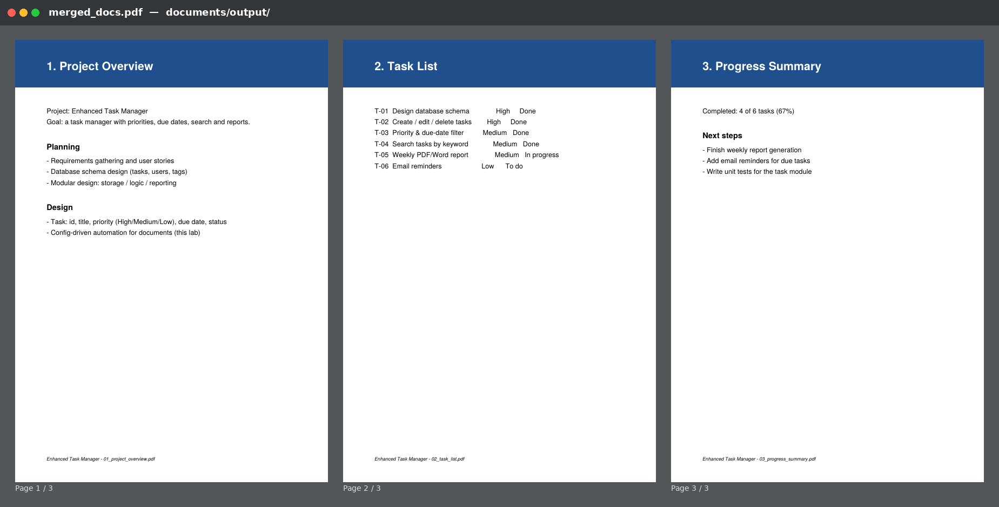
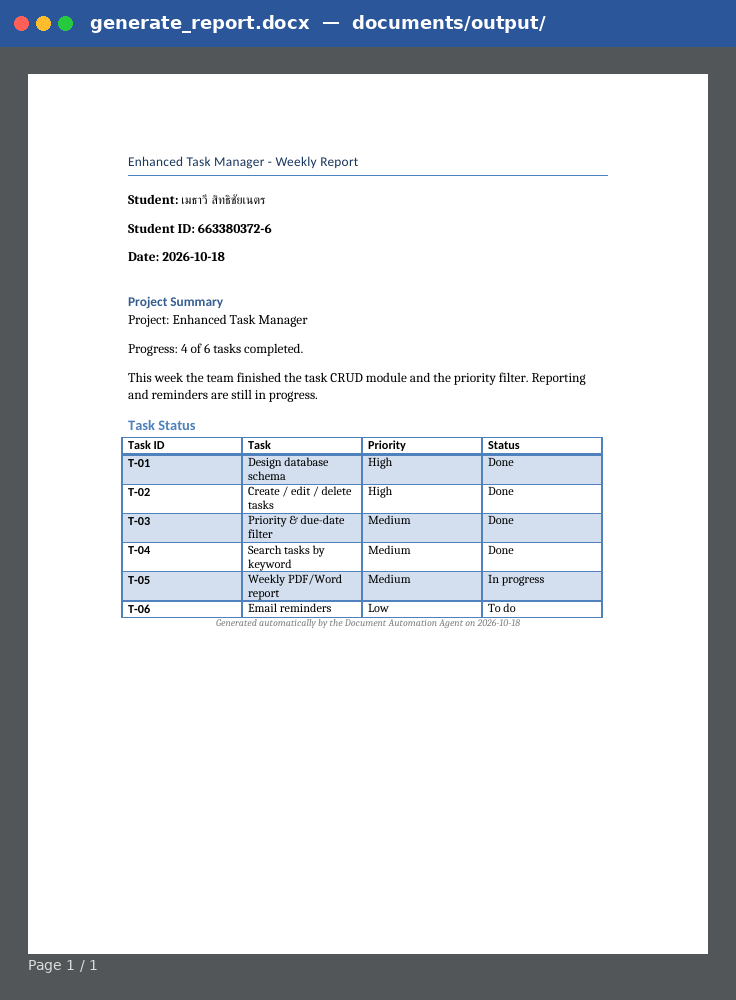
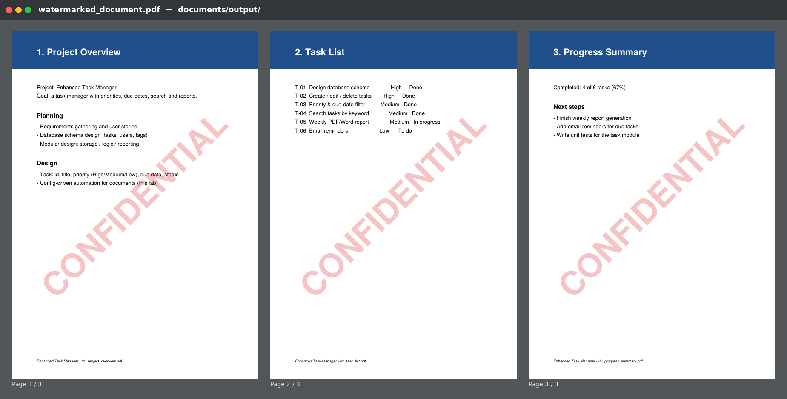

# Week11_LabX ADV_663380372-6
## Project Planning & Design: Building an Enhanced Task Manager (Document Automation Agent)

ผู้จัดทำ: เมธาวี สิทธิชัยเนตร, รหัสนักศึกษา 663380372-6

**Document Automation Agent** แบบ config-driven อ่านลำดับงานจาก `configs/document_tasks_config.json` แล้วทำเอกสารของโปรเจกต์ Enhanced Task Manager อัตโนมัติ 3 ขั้น
1. **รวม PDF** 3 ไฟล์ใน `documents/` (Project Overview, Task List, Progress Summary) เป็น `merged_docs.pdf` ด้วย PyPDF2
2. **สร้างรายงาน Word** จากเทมเพลต `templates/report_template.docx` โดยแทนค่า `{{placeholder}}` และเพิ่มตารางสถานะงาน ได้ไฟล์ `generate_report.docx` ด้วย python-docx
3. **ใส่ลายน้ำ** "CONFIDENTIAL" แบบโปร่งแสงเอียง 45° ลงทุกหน้าของ `merged_docs.pdf` ได้ไฟล์ `watermarked_document.pdf` ด้วย reportlab และ PyPDF2

ทุกขั้นตอนถูกบันทึกลง audit log (`reports/audit_report_*.json`)

## 📸 Screenshots

### 1. `merged_docs.pdf`: รวม 3 PDF เป็นไฟล์เดียว (3 หน้า)


### 2. `generate_report.docx`: รายงานจากเทมเพลต (ชื่อ, รหัส, วันที่, สรุป, ตาราง Task Status)


### 3. `watermarked_document.pdf`: ใส่ลายน้ำ CONFIDENTIAL ทุกหน้า


## วิธีรัน
```bash
python -m venv venv
venv\Scripts\activate              # macOS/Linux: source venv/bin/activate
pip install -r requirements.txt
python create_sample_documents.py  # สร้าง PDF ตัวอย่าง 3 ไฟล์ + เทมเพลต Word (มีให้แล้วใน repo)
python main.py
```
ผลลัพธ์อยู่ใน `documents/output/`

## Configuration (`configs/document_tasks_config.json`)
| Task type | Parameters |
|---|---|
| `merge_pdfs` | `input_files` (list), `output_file` |
| `generate_report` | `template`, `output_file`, `context` (ค่าที่จะแทนใน `{{...}}`), `table` (title/headers/rows) |
| `add_watermark` | `input_file`, `output_file`, `watermark_text`, `opacity`, `font_size`, `angle` |

ถ้าจะเพิ่มหรือเปลี่ยนงาน ให้แก้ที่ config ได้เลย ไม่ต้องแก้โค้ด

## Project Structure
```
Week11_LabX ADV_663380372-6/
├── configs/
│   └── document_tasks_config.json
├── documents/
│   ├── 01_project_overview.pdf
│   ├── 02_task_list.pdf
│   ├── 03_progress_summary.pdf
│   └── output/
│       ├── merged_docs.pdf
│       ├── generate_report.docx
│       └── watermarked_document.pdf
├── src/
│   ├── __init__.py
│   ├── document_agent.py     # Agent: อ่าน config, dispatch task, audit log
│   ├── config_parser.py      # โหลดและ validate config
│   ├── pdf_tasks.py          # merge_pdfs, add_watermark
│   ├── word_tasks.py         # generate_report (template + table)
│   └── utils.py              # logging, audit helpers
├── templates/
│   └── report_template.docx
├── screenshots/
├── create_sample_documents.py
├── main.py
├── requirements.txt
├── .gitignore
└── README.md
```
