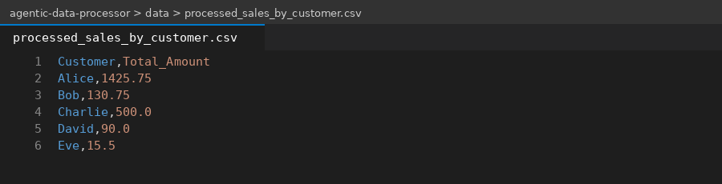
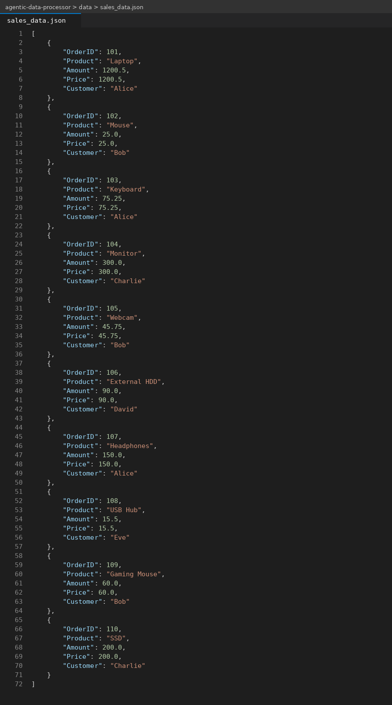
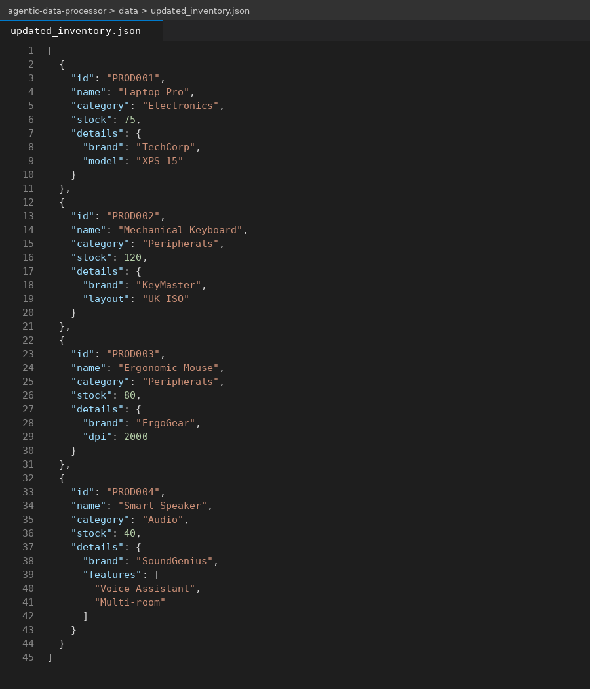

# Week 8 LabX ADV: Agentic Data Processing (Advanced CSV & JSON Workflows)

ผู้จัดทำ: เมธาวี สิทธิชัยเนตร, รหัสนักศึกษา 663380372-6

**Agentic Data Processor** อ่าน pipeline จาก `configs/data_pipeline_config.json` แล้วรันทีละ task ตามลำดับ ส่งข้อมูลระหว่าง task ผ่าน `data_store` ภายใน agent และบันทึกทุกขั้นตอนลง audit report

## 📸 Screenshots (ผลลัพธ์)

### 1. `data/processed_sales_by_customer.csv`: ยอดขายรวมแยกตามลูกค้า


### 2. `data/sales_data.json`: แปลง input_sales.csv เป็น JSON (แปลงตัวเลขเป็น int/float)


### 3. `data/updated_inventory.json`: inventory หลังอัปเดต stock/details และเพิ่มสินค้า PROD004


## Pipeline (ตาม `configs/data_pipeline_config.json`)

| # | Task | Type | ผลลัพธ์ |
|---|---|---|---|
| 1 | Load Sales Data CSV | `load_csv` | `raw_sales_data` |
| 2 | Aggregate Sales by Customer | `transform_csv_aggregate` (sum `Amount` by `Customer`) | `customer_sales_summary` |
| 3 | Save Aggregated Sales CSV | `save_csv` | `data/processed_sales_by_customer.csv` |
| 4 | Convert Raw Sales to JSON | `csv_to_json_conversion` | `raw_sales_json` |
| 5 | Save Raw Sales JSON | `save_json` | `data/sales_data.json` |
| 6 | Load Inventory Data JSON | `load_json` | `raw_inventory_data` |
| 7 | Update Inventory Stock & Add Product | `update_json_data` | `updated_inventory_data` |
| 8 | Query Specific Product Detail | `query_json_data` (`0.details.brand` → `TechCorp`) | `queried_product_brand` |
| 9 | Save Updated Inventory JSON | `save_json` | `data/updated_inventory.json` |

การอัปเดตในขั้นที่ 7 มีดังนี้
- PROD001 `stock` → 75
- PROD002 `layout` → UK ISO
- PROD003 `dpi` → 2000
- เพิ่ม PROD004 Smart Speaker
- path `PROD001.details.color` ใช้ไม่ได้ เพราะ root เป็น list ต้องอ้างด้วย index เช่น `0.details.color` agent จะ log WARNING แล้วข้าม update นี้ไป เป็นการสาธิต error handling

## วิธีรัน
```bash
python -m venv venv
venv\Scripts\activate          # macOS/Linux: source venv/bin/activate
python main.py
```
ใช้แค่ built-in modules (`csv`, `json`, `logging`) จึงไม่ต้องติดตั้งอะไรเพิ่ม ผลลัพธ์จะอยู่ใน `data/` และ audit report อยู่ใน `reports/audit_report_*.json`

## Project Structure
```
agentic-data-processor/
├── src/
│   ├── __init__.py
│   ├── data_agent.py          # Agent: อ่าน config, dispatch task, จัดการ data_store, audit log
│   ├── csv_tasks.py           # load / save / aggregate / filter CSV
│   ├── json_tasks.py          # load / save / update / query JSON
│   ├── conversion_tasks.py    # CSV <-> JSON
│   ├── config_parser.py       # โหลดและ validate config
│   └── utils.py               # logging, directory, audit log helpers
├── configs/
│   └── data_pipeline_config.json
├── data/
│   ├── input_sales.csv
│   ├── input_inventory.json
│   ├── processed_sales_by_customer.csv   # output
│   ├── sales_data.json                   # output
│   └── updated_inventory.json            # output
├── screenshots/
├── main.py
├── .gitignore
└── README.md
```

## สิ่งที่แก้จาก starter code
- `main.py`: เปลี่ยนเป็น `from src.config_parser import ...` เพราะโมดูลใน `src/` ใช้ relative import (`from .utils import ...`) ถ้า import แบบเดิมจะเจอ `ImportError`
- `json_tasks.py`: ลบ `from turtle import update` และ `from os import path` ที่ไม่ได้ใช้และติดมาโดยไม่ตั้งใจ (`turtle` โหลด tkinter และอาจทำให้ error)
- `utils.py`: ตั้ง `logger.propagate = False` เพื่อไม่ให้ log ทุกบรรทัดแสดงซ้ำสองครั้ง
- `.gitignore`: ไม่ ignore ไฟล์ output 3 ไฟล์ใน `data/` เพื่อให้เห็นผลลัพธ์บน GitHub
