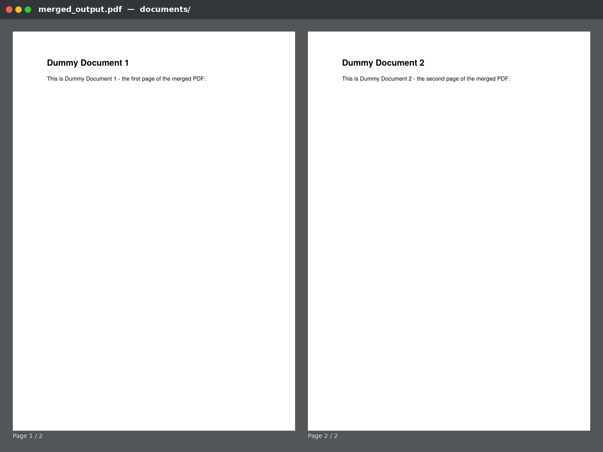
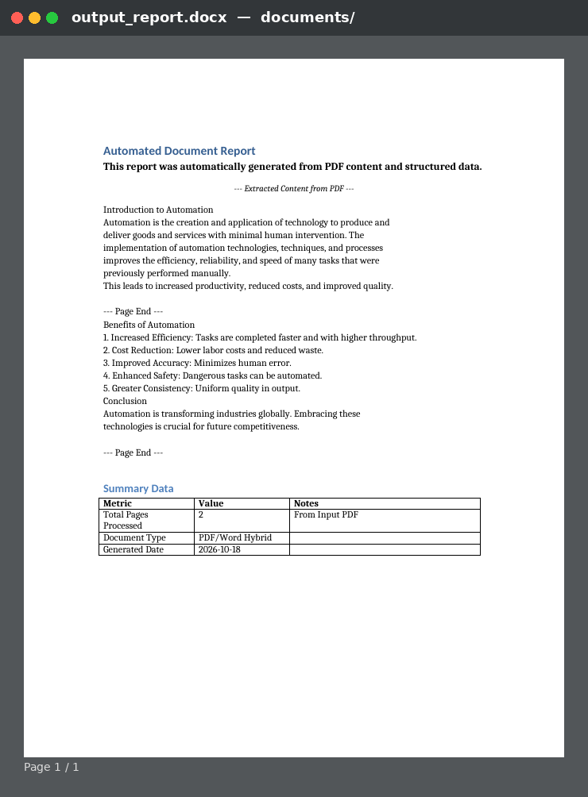

# Week 11: Automating PDFs & Word Documents

This project demonstrates how to automate common tasks involving PDF and Word documents using Python. It leverages `PyPDF2` for PDF manipulation and `python-docx` for Word document creation and modification.

## Screenshots (Results)

### 1. `merged_output.pdf` — dummy_doc1.pdf + dummy_doc2.pdf merged with PyPDF2


### 2. `output_report.docx` — text extracted from input_article.pdf + heading, formatted text and table


## Key Concepts Demonstrated

* **PDF Text Extraction**: Reading text content from PDF files.
* **PDF Merging**: Combining multiple PDF files into a single document.
* **PDF Splitting**: Splitting a PDF into smaller files (`split_pdf`).
* **Word Document Creation**: Programmatically generating new `.docx` files.
* **Adding Content to Word**: Inserting headings, paragraphs, formatted text (bold, italic, font size), and tables.
* **Modular Design**: Separating PDF and Word processing logic into distinct modules (`pdf_processor.py`, `word_processor.py`).
* **Robustness**: Basic error handling for file operations and library interactions, with logging for workflow visibility.

## Setup & How to Run

1. **Clone the repository**
   ```bash
   git clone https://github.com/YOUR_USERNAME/document-automator.git
   cd document-automator
   ```
2. **Install dependencies** (virtual environment recommended)
   ```bash
   python -m venv venv
   source venv/bin/activate      # Windows: venv\Scripts\activate.bat
   pip install -r requirements.txt
   ```
3. **Prepare input documents** — generate the sample PDFs (`input_article.pdf`, `dummy_doc1.pdf`, `dummy_doc2.pdf`):
   ```bash
   python create_sample_pdfs.py
   ```
4. **Run the script**
   ```bash
   python main.py
   ```
   The script will:
   * Extract text from `documents/input_article.pdf`.
   * Create `documents/output_report.docx` containing the extracted text, a custom heading, formatted text and a summary table.
   * Merge `dummy_doc1.pdf` and `dummy_doc2.pdf` into `documents/merged_output.pdf`.

## Project Structure

```
document-automator/
├── src/
│   ├── __init__.py          # Python package marker
│   ├── pdf_processor.py     # PyPDF2 operations (extract, merge, split)
│   ├── word_processor.py    # python-docx operations (create, add content, format)
│   └── utils.py             # General utilities (logging, directory creation)
├── documents/
│   ├── input_article.pdf    # Sample PDF for text extraction
│   ├── dummy_doc1.pdf       # Sample PDF for merging
│   ├── dummy_doc2.pdf       # Sample PDF for merging
│   ├── output_report.docx   # Generated Word document
│   └── merged_output.pdf    # Generated merged PDF
├── screenshots/
│   ├── merged_output_pdf.png
│   └── output_report_docx.png
├── create_sample_pdfs.py    # Creates the sample input PDFs (reportlab)
├── main.py                  # Application entry point
├── requirements.txt
├── .gitignore
└── README.md
```

## Fixes made to the lab's starter code

* `main.py` imported modules via `sys.path` + `from pdf_processor import ...`, which breaks the relative imports (`from .utils import ...`) inside `src/`. Changed to `from src.pdf_processor import ...`.
* `datetime` is now imported at the top of `main.py` (it was imported only under `if __name__ == "__main__"`).
* `split_pdf` used `range(0_int, ...)` (syntax error) → `range(0, ...)`, and `ensure_directory_exists` is now imported in `pdf_processor.py`.
* `extract_text()` may return `None` for image-only pages → handled with `or ""`.

## Debugging Document Automation

* **`FileNotFoundError`**: Ensure the input PDFs are in `documents/` (run `python create_sample_pdfs.py`).
* **`PyPDF2.errors.PdfReadError`**: The PDF may be corrupted, encrypted, or not a valid PDF.
* **Blank Word document**: Check that `extract_text_from_pdf()` returned text — image-based PDFs contain no selectable text.
* **Formatting issues**: Font sizes use `Pt()`; formatting is applied to `paragraph.runs[0]`.
* **Logging output**: Watch for `ERROR` / `WARNING` messages in the console.
