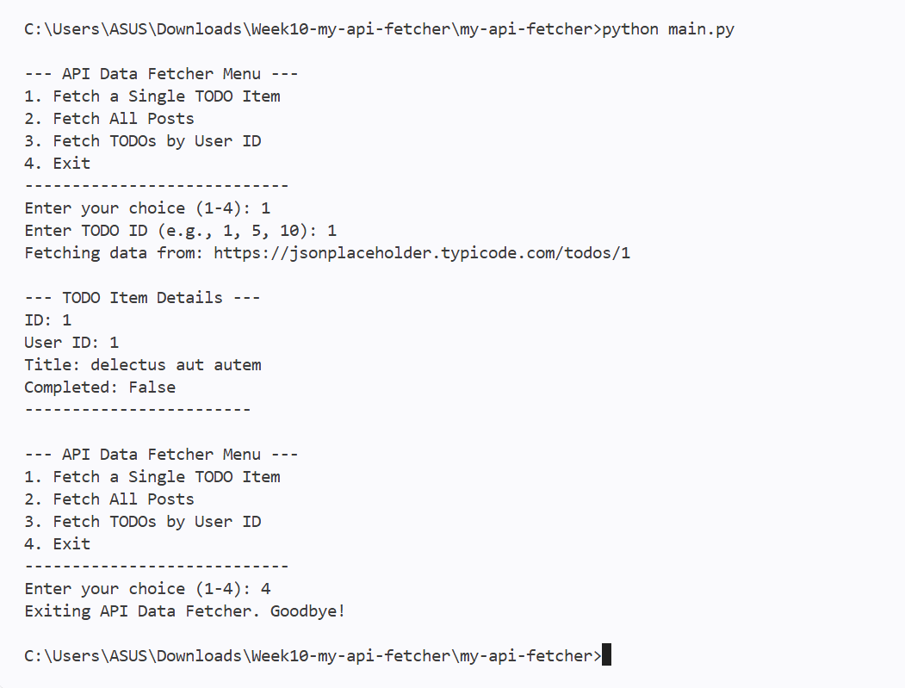

# My API Data Fetcher CLI (Week 10)

ผู้จัดทำ: เมธาวี สิทธิชัยเนตร, รหัสนักศึกษา 663380372-6

โปรแกรม command line ที่ใช้ไลบรารี `requests` ดึงข้อมูล JSON จาก [JSONPlaceholder](https://jsonplaceholder.typicode.com/) (fake REST API) แล้วแสดงผลแบบอ่านง่าย พร้อม error handling

## 📸 Screenshots

### 1. Fetch a Single TODO Item


### 2. Fetch All Posts


### 3. Fetch TODOs by User ID


## Features
* **Fetch Single TODO**: ดึง TODO ตาม ID (`GET /todos/{id}`)
* **Fetch All Posts**: ดึงโพสต์ทั้งหมด (`GET /posts`) แสดง 5 โพสต์แรก
* **Fetch User TODOs**: ดึง TODO ทั้งหมดของ user (`GET /todos?userId={id}`) แสดงสถานะ Completed/Pending
* **Error Handling**: `HTTPError`, `ConnectionError`, `Timeout`, `RequestException`, `JSONDecodeError` และกรณีผู้ใช้ป้อนค่าที่ไม่ใช่ตัวเลข
* **JSON Processing**: `response.json()` แปลงข้อมูลเป็น dict/list แล้วใช้ `.get()` ดึงค่า

## How to Run
```bash
python -m venv venv
venv\Scripts\activate          # macOS/Linux: source venv/bin/activate
pip install -r requirements.txt
python main.py
```

## Project Structure
```
my-api-fetcher/
├── src/
│   ├── __init__.py       # Makes 'src' a Python package
│   └── api_client.py     # APIClient class: encapsulates API interaction logic
├── screenshots/
├── main.py               # Main entry point, handles CLI and calls api_client
├── .gitignore
├── README.md
└── requirements.txt      # requests==2.32.3
```
